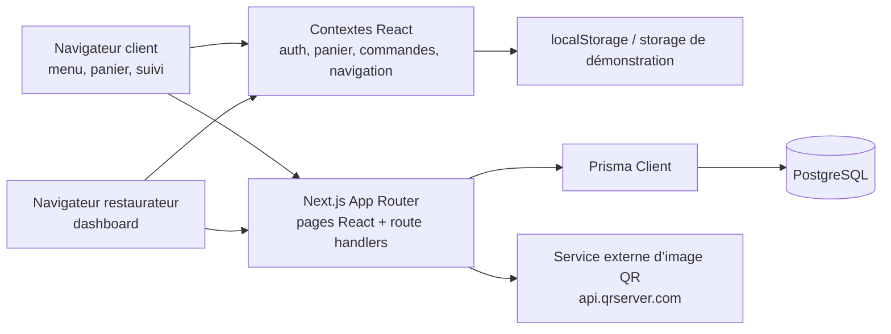

# QResto — vue d’ensemble du projet

> État observé dans le code lors du dernier audit. Ce document décrit le dépôt tel qu’il est écrit ; il ne vaut ni validation de production ni audit de sécurité exhaustif.

## Table des matières

1. [Présentation du projet](#1-présentation-du-projet)
2. [Stack technique et architecture](#2-stack-technique-et-architecture)
3. [Fonctionnalités existantes](#3-fonctionnalités-existantes)
4. [Travail réalisé jusqu’à présent](#4-travail-réalisé-jusquà-présent)
5. [Audit du design actuel (front-end public)](#5-audit-du-design-actuel-front-end-public)
6. [Direction de refonte du design — à reprendre ultérieurement](#6-direction-de-refonte-du-design--à-reprendre-ultérieurement)
7. [Fonctionnalités proposées](#7-fonctionnalités-proposées)
8. [Feuille de route](#8-feuille-de-route)
9. [Guide pour reprendre le projet](#9-guide-pour-reprendre-le-projet)

## 1. Présentation du projet

QResto est une application web de digitalisation des restaurants, orientée notamment vers le Bénin et l’Afrique de l’Ouest. Elle vise deux publics :

- **Restaurateurs et équipes** : publier un menu, administrer les plats et les tables, recevoir et faire avancer les commandes, gérer des membres du personnel et consulter un espace d’administration.
- **Clients finaux** : découvrir un établissement, consulter son menu sans créer de compte, ajouter des plats au panier, commander sur place, à emporter ou en livraison, puis rechercher l’état de la commande par son code.

La proposition de valeur est de relier le menu numérique et la prise de commande au fonctionnement du restaurant : le QR peut contenir le numéro de table, les commandes sont stockées et consultables dans le dashboard, et le client dispose d’une page de suivi. Le dépôt contient aussi une vitrine marketing et des écrans d’abonnement.

**Limites de l’état actuel :** le code propose des choix de paiement Mobile Money et carte, mais aucun flux de paiement externe n’est visible ; la commande est enregistrée avec un statut de paiement `PENDING`. Les promesses marketing doivent donc être distinguées des intégrations réellement actives.

## 2. Stack technique et architecture

### Technologies observées

| Couche | Technologies et constats |
|---|---|
| Application web | Next.js 16 (App Router), React 19, TypeScript. Routes et pages dans `src/app/`. |
| Interface | Tailwind CSS 4 via `@tailwindcss/postcss`, CSS global et variables de thème dans `src/app/globals.css` et `src/app/design-system.css`. Icônes `lucide-react` et Font Awesome chargé via CDN. Animations avec `motion`/`motion/react` et `framer-motion` importés selon les composants. |
| Serveur / API | Route handlers Next.js dans `src/app/api/`. Authentification par cookie JWT signé avec `jose`; mots de passe hachés avec `bcryptjs`. |
| Données | PostgreSQL via Prisma 6. Schéma dans `prisma/schema.prisma`, migrations dans `prisma/migrations/`, client généré vers `generated/prisma`. Accès partagé par `src/lib/prisma.ts`. |
| État client | Contextes React dans `src/context/`; le panier est conservé dans `localStorage`. Le module `src/lib/storage.ts` fournit également des données de démonstration / accès au stockage navigateur pour une partie du dashboard. |
| QR et médias | `qrcode` est une dépendance ; les routes QR construisent les URLs et, dans `src/app/api/qr-codes/route.ts`, renvoient aussi une URL d’image fournie par `api.qrserver.com`. Images statiques présentes sous `public/images/` et également copiées dans d’autres chemins d’assets. |
| Déploiement | Aucune configuration de déploiement, conteneur ou pipeline CI n’a été repérée dans les fichiers de configuration du dépôt. `.env.example` mentionne AI Studio / Cloud Run dans ses commentaires ; l’hébergement réellement utilisé est **à confirmer**. |

### Schéma d’architecture



Les mises à jour de commandes sont actuellement rafraîchies par polling côté navigateur (toutes les 5 secondes côté suivi client et 10 secondes côté dashboard), et non par WebSocket ou SSE.

### Rôle des dossiers principaux

| Chemin | Rôle |
|---|---|
| `src/app/` | Pages Next.js, layout global, styles globaux et routes API. |
| `src/app/api/auth/` | Inscription, connexion, déconnexion et vérification de session. |
| `src/app/api/` (autres routes) | Endpoints restaurants, commandes, catégories, plats, tables, QR, équipe, paramètres, abonnements, analytics et recommandations. |
| `src/components/pages/LandingPage/` | Sections de la vitrine marketing. |
| `src/components/customer/` | Annuaire, fiche/menu restaurant, panier et suivi de commande. |
| `src/components/dashboard/` | Shell et onglets de gestion du restaurant. |
| `src/components/auth/` | Écrans et formulaires de connexion et d’inscription. |
| `src/components/common/`, `src/components/ui/` | Navigation, messages, icônes et composants UI génériques. |
| `src/context/` | États partagés de session, navigation, panier, commandes et notifications. |
| `src/lib/` | Client Prisma et fonctions de stockage navigateur / démonstration. |
| `src/types/`, `src/utils/`, `src/constants/` | Types, utilitaires et données constantes de vitrine. |
| `prisma/` | Modèle relationnel et historique des migrations. |
| `public/images/` | Images servies statiquement par Next.js. |

### Principales entités et relations

Le modèle de données est défini dans `prisma/schema.prisma`.

- `User` peut posséder un `Restaurant` (relation propriétaire avec `ownerId` unique), être associé directement à un restaurant comme personnel et/ou être relié à un `TeamMember`.
- `Restaurant` possède plusieurs `TeamMember`, `Category`, `Dish`, `RestaurantTable`, `Order`, `Review`, `Coupon`, historiques d’abonnement et `Notification`. Il a aussi des `RestaurantSettings` et une `Subscription` uniques.
- `Category` regroupe plusieurs `Dish`. Un plat peut avoir des groupes d’options `DishOptionGroup`, eux-mêmes composés de `DishOption`.
- `Order` appartient à un restaurant et contient des `OrderItem` et un historique `OrderStatusHistory`. Les lignes de commande gardent nom/prix/quantité et peuvent survivre à la suppression d’un plat via `dishId` optionnel.
- `Review` appartient à un restaurant et peut viser un plat.
- `Subscription` appartient à un restaurant et possède plusieurs `Invoice`. `SubscriptionHistory` représente aussi des événements d’abonnement distincts.
- `Coupon` et `Notification` appartiennent à un restaurant.
- `Testimonial` et `FAQItem` sont des entités sans relation obligatoire à un restaurant.

**À noter :** le schéma contient des entités de stock implicite/évolutions possibles (options de plats, avis, coupons, notifications), mais leur présence dans le schéma ne signifie pas que leur interface ou leur cycle de vie fonctionnel sont implémentés.

## 3. Fonctionnalités existantes

Légende : **✅ terminé dans le périmètre observé** ; **🟡 partiel / simulé / dépendant d’un flux incomplet** ; **❌ incohérent ou en échec visible dans le code**.

### Front public

| Parcours | État | Ce qui est effectivement présent |
|---|---:|---|
| Accueil marketing (`/`) | 🟡 | Sections hero, étapes, plats, simulateur QR, restaurants, prix, témoignages, FAQ et CTA. Certaines statistiques et promesses sont des textes fixes, non reliés à des données ou à une mesure visible. |
| Annuaire (`/restaurants`) | ✅ | Charge `/api/restaurants`, recherche texte, filtres par villes prédéfinies et filtre « ouverts ». Affiche chargement, erreur, résultats et état vide. Le filtre de catégorie existe dans l’état mais ses choix sont à vérifier dans l’interface. |
| Menu restaurant (`/restaurant/[slug]`) | ✅ | Charge le restaurant par slug via `/api/restaurants/[slug]`, affiche catégories/plats disponibles, filtre par catégorie, lien partageable, ajout au panier et modal de visualisation 3D si le plat le permet. Le paramètre `?table=` est transmis vers le panier. |
| Panier et formulaire (`/cart`) | 🟡 | Panier local, modification/suppression des quantités, choix sur place/retrait/livraison, coordonnées, adresse ou table, mode de paiement et création de commande. L’intégration des données restaurant dans la page comporte une incohérence d’identifiant décrite en section 4. |
| Paiement | 🟡 | Les choix `CASH_ON_DELIVERY`, `MTN_MOMO`, `MOOV_MONEY` et `CARD` existent. Le serveur persiste le moyen et crée la commande en `PENDING`; aucune passerelle, confirmation de paiement ou webhook n’est visible. |
| Suivi (`/order-tracking`) | ✅ / 🟡 | Recherche par code, timeline et historique, actualisation manuelle et polling client. Le statut `CANCELLED` a un message dédié. Le polling ne met à jour l’état affiché qu’en cas de changement de statut. |
| Contact et pages légales | 🟡 | Pages CGU, confidentialité et contact présentes. Le formulaire contact affiche un succès et vide ses champs sans appel API visible. Les informations de tarifs dans les CGU ne concordent pas avec le catalogue d’abonnements de l’API. |
| Accès client sans compte | ✅ | Aucun compte client n’est exigé ; le téléphone indiqué à la commande est validé comme numéro WhatsApp/contact requis. L’envoi automatique WhatsApp du code de suivi n’est pas implémenté. |

### Dashboard

| Section | État | Éléments observés |
|---|---:|---|
| Établissement / Paramètres généraux | ✅ | Chargement des informations via `/api/settings`, champs nom/téléphone/adresse/devise/description préremplis à partir des paramètres ou des données du restaurant. La sauvegarde met également à jour le profil restaurant. |
| Horaires | ✅ | Édition des jours actifs et heures d’ouverture/fermeture, validation de format et sauvegarde JSON synchronisée aux paramètres et au restaurant. |
| Enregistrer / rafraîchir les paramètres | ✅ | Le bouton Enregistrer est désactivé si le formulaire n’a pas changé ; actualisation via `fetchSettings`; notifications de succès/erreur présentes. |
| Abonnement | 🟡 | Onglet visible, chargement du plan, catalogue, factures et action de changement de plan. L’API crée/actualise l’abonnement et une facture, mais aucun paiement réel n’est intégré. |
| Équipe | 🟡 | Liste, recherche, filtres par rôle, ajout, édition, activation/désactivation et suppression via `/api/team`. Les opérations sont limitées au restaurant de la session. La création d’un `TeamMember` ne crée toutefois pas de compte `User`; la connexion réelle des nouveaux membres reste à confirmer/implémenter. |
| Plats | ✅ / 🟡 | Liste, recherche, catégorie, disponibilité, ajout/édition/suppression via API. Le formulaire exige une image/URL ; la gestion de chargement réel d’un fichier n’est pas confirmée. |
| Catégories | ✅ | CRUD par API, catégories triées et suppression empêchée si des plats y sont encore associés. |
| Commandes | ✅ / 🟡 | Tableau Kanban, détail, progression de statut et rafraîchissement périodique. Le tableau utilise une grille responsive à quatre colonnes à partir du breakpoint `lg` (sept statuts, donc répartis sur plusieurs lignes). Les appels d’actualisation et changements d’état ne présentent pas partout un état d’erreur visible dans l’interface. |
| Tables et QR codes | ✅ / 🟡 | Gestion des tables et affichage de QR avec URL restaurant/table. Les images QR renvoient à un service externe ; dépendance et disponibilité externe à prendre en compte. |
| Analytics | 🟡 | L’endpoint `/api/analytics` utilise maintenant les champs du modèle Prisma actuel et filtre par restaurant de session. Le dashboard conserve des données de démonstration/locales pour certaines ressources ; les chiffres doivent être validés avec des données réelles. |
| Accès dashboard | ✅ / 🟡 | Le middleware vérifie le JWT et permet les rôles propriétaire et staff; chaque endpoint d’administration vérifie aussi la session, le rôle et l’isolation restaurant. Le mécanisme n’octroie pas de compte à un `TeamMember` créé depuis l’interface, ce qui limite l’usage effectif des rôles staff. |

### API et données

| Groupe d’API | État | Couverture observée |
|---|---:|---|
| `/api/auth/*` | ✅ | `POST` login/register/logout et `GET` `/me`; mots de passe bcrypt, cookie `auth_token` HttpOnly et `JWT_SECRET` obligatoire, sans valeur de repli. |
| `/api/restaurants`, `/api/restaurants/[slug]`, `/api/restaurants/featured` | ✅ / 🟡 | Annuaire, fiche/menu par slug et restaurants mis en avant. Les réponses publiques sélectionnent des champs nécessaires au parcours et n’incluent pas l’ID propriétaire ni son e-mail. |
| `/api/orders`, `/api/orders/[trackingCode]` | ✅ / 🟡 | Création publique avec téléphone obligatoire, prix recalculés depuis les plats disponibles du restaurant, code de suivi aléatoire, lecture publique limitée au DTO client et mises à jour de statut protégées/scopées au restaurant. Codes historiques `QR-####` et nouveaux codes `QR-` + 12 caractères hexadécimaux sont acceptés. Limitation de débit locale au processus. |
| `/api/dishes`, `/api/categories`, `/api/tables`, `/api/team`, `/api/settings` | ✅ / 🟡 | Endpoints d’administration authentifiés, validés par Zod et filtrés avec le restaurant de session. Les permissions dépendent du rôle staff codé côté serveur; les comptes staff et l’usage du champ libre `TeamMember.permissions` ne sont pas raccordés/confirmés. `/api/dishes/showcase` est une lecture publique dédiée à la vitrine. |
| `/api/subscription` | 🟡 | Lecture/initialisation d’essai, changement de plan et création de facture; réservé au propriétaire selon la matrice de rôles. Pas de prestataire de paiement visible. |
| `/api/qr-codes` | ✅ / 🟡 | Lecture des tables protégée par rôle, URLs QR construites depuis l’origine configurée/requête et image référencée à un service externe. |
| `/api/recommendations` | 🟡 | Renvoie des formules construites à partir de plats de `storage`, avec prix et sélection en partie codés en dur; le paramètre `mood` est validé mais le moteur n’est pas personnalisé par restaurant. |
| `/api/analytics` | 🟡 | Requête alignée sur le schéma Prisma actuel et filtrée par le restaurant de session; les analytics et données dashboard doivent encore être vérifiés en environnement connecté. |

## 4. Travail réalisé jusqu’à présent

### État des améliorations dashboard mentionnées

| Amélioration attendue | Présence dans le code |
|---|---|
| Pré-remplissage des informations établissement | **Oui.** `GET /api/settings` crée des paramètres initiaux à partir du restaurant et `SettingsTab` remplit le formulaire avec ces valeurs. |
| Bouton Enregistrer désactivé sans modification | **Oui.** `SettingsTab` compare un snapshot JSON et transmet `isDirty` à `Header`; l’action est désactivée si `!isDirty`. |
| Rafraîchissement des informations | **Oui.** `Header` déclenche `fetchSettings()` avec `cache: 'no-store'`. |
| Horaires modifiables | **Oui.** `OpeningHoursSection` gère l’activation par jour et les deux champs horaires ; `SettingsTab` valide puis enregistre. |
| Section Abonnement visible | **Oui.** Elle est déclarée dans les items de navigation du dashboard et rend `SubscriptionTab`. Le paiement de l’abonnement n’est toutefois pas intégré. |
| Ajout d’un membre avec le bon ID de restaurant | **Oui.** La création vérifie `restaurantId` puis l’inclut dans le payload POST de `TeamTab`. |
| Formulaire de plat | **Oui.** Création/édition avec nom, prix, catégorie, image et disponibilité, puis appel API. Le formulaire bloque la soumission sans image/URL. |
| Étapes/colonnes de commande en quatre par ligne | **Oui pour le Kanban dashboard.** `OrdersTab` utilise `grid-cols-1 sm:grid-cols-2 md:grid-cols-3 lg:grid-cols-4`. Le suivi client a, lui, six étapes et une grille de six colonnes à partir de `md`. |

### Résumé de ce qui est construit

- Une application App Router avec pages publiques, authentification propriétaire, parcours de commande et dashboard.
- Un schéma PostgreSQL/Prisma assez large (restaurant, équipe, menu, tables, commandes, abonnements, factures, avis, coupons, notifications) et six migrations visibles.
- Des handlers API pour les opérations principales et des formulaires de gestion.
- Une vitrine marketing constituée de sections modulaires, des images de démonstration et un simulateur de QR.
- Une base de styles avec palette claire, couleurs chaudes et composants utilitaires, mais appliquée de façon inégale sur le front public.

### Socle qualité et sécurité ajouté

- `next.config.mjs` ne masque plus les erreurs de TypeScript/ESLint; `tsconfig.json` active `strict: true`. Le script `lint` lance ESLint CLI et `test` lance Vitest. `yarn.lock` est le lockfile de référence; `bun.lock` a été supprimé.
- ESLint 9 et `eslint-config-next` sont alignés sur Next 16.3.6. `yarn lint` s’exécute sans erreur bloquante; des avertissements de base subsistent (apostrophes JSX, effets React, `` et variables/imports inutilisés). Aucun `any` explicite ne reste dans `src/`.
- `src/lib/auth/jwt.ts`, `src/lib/auth/session.ts` et `src/lib/auth/permissions.ts` centralisent la vérification du cookie, le rechargement du compte depuis la base et la matrice des rôles. `JWT_SECRET` n’a pas de valeur de repli. Le middleware accepte le propriétaire et le staff; les handlers appliquent ensuite leur permission.
- Le propriétaire dispose des permissions d’administration; `MANAGER` gère menu, commandes, tables, QR et analytics; `CHEF` gère menu et commandes; `WAITER` gère commandes, lecture tables et QR; `CASHIER` gère commandes et analytics; `DELIVERY` gère les commandes. La matrice est dans `src/lib/auth/permissions.ts`.
- Les endpoints admin des plats, catégories, tables, équipe, paramètres, abonnement, QR, analytics et commandes utilisent l’ID restaurant issu de la session pour filtrer les requêtes. Les entrées correspondantes sont validées par Zod; les réponses distinguent validation, authentification, autorisation et ressource absente.
- La création publique de commande exige un numéro de téléphone/WhatsApp, recharge les plats/prix/disponibilités dans Prisma et calcule le montant serveur. Le suivi public ne renvoie que code, nom public du restaurant, statut, lignes (nom/prix/quantité), total et historique; les coordonnées client ne sont pas incluses. Les codes historiques `QR-####` et les nouveaux `QR-` + 12 caractères hexadécimaux sont acceptés.
- `src/lib/rate-limit.ts` limite la création de commandes (10 requêtes / 10 min / IP) et le suivi (180 / 15 min / IP). La mémoire est locale au processus; les quotas ne sont pas partagés entre instances. La confiance envers `x-real-ip`/`x-forwarded-for` dépend du proxy de déploiement (**à confirmer**).
- Vitest couvre le comportement du limiteur et deux aspects de l’isolation des commandes. Les tests API mockent Prisma et vérifient le filtre tenant ainsi que l’absence d’update quand une commande étrangère n’est pas trouvée; ils ne remplacent pas des tests d’intégration PostgreSQL.
- `/api/dishes/showcase` fournit les données publiques de la vitrine sans rendre publique la route d’administration `/api/dishes`. Des frontières Suspense autour des composants utilisant `useSearchParams` permettent aussi au build Next de terminer.

### Dette technique, incohérences et bugs à traiter

1. **Comportement panier / restaurant — incohérence de signature.** Dans `RestaurantDetailPage`, `addToCart(dish, 1, restaurant?.id)` transmet l’ID du restaurant comme troisième argument, alors que `CartContext.addToCart` attend un texte de notes à cette position. L’appel persiste donc potentiellement l’ID comme note de plat ; de plus, le contexte affiche déjà un toast, puis la page en affiche un second.
2. **Chargement restaurant depuis le panier.** `CartPage` appelle `/api/restaurants/${targetRestaurantId}` avec l’ID de restaurant, alors que `src/app/api/restaurants/[slug]/route.ts` recherche exclusivement par `slug`. Les données de livraison/affichage peuvent ne pas se charger. La commande est néanmoins envoyée avec l’ID conservé dans le contexte.
3. **Route de rechargement inexistante.** `AuthContext.reloadRestaurantData()` appelle `/api/restaurant/me`; aucune route de ce nom n’est présente dans l’arborescence actuelle. L’effet est **à confirmer en usage** selon les appelants.
4. **Authentification staff incomplète.** `POST /api/team` crée un `TeamMember`, mais ne crée ni ne lie un `User`; un membre créé n’a donc pas nécessairement de compte de connexion. Le processus d’invitation/activation est à confirmer.
5. **Permissions personnalisées non raccordées.** Le modèle `TeamMember.permissions` existe, mais l’API applique la matrice fixe issue de `TeamMember.role`. L’usage souhaité des permissions personnalisées est à confirmer.
6. **Données de démonstration et données DB mélangées.** `RestaurantDashboard` initialise restaurants/plats/catégories/tables depuis `storage`; certaines sections lancent aussi leurs propres fetch API et les commandes viennent de PostgreSQL. Le TODO dans `RestaurantDashboard.tsx` indique explicitement que d’autres ressources doivent encore migrer vers Fetch API.
7. **État ouvert/avis par défaut dans la fiche restaurant.** `RestaurantHero` affiche « Ouvert » en dur et utilise `restaurant.reviewCount || 140`; une absence de valeur est donc présentée comme 140 avis. L’annuaire affiche aussi une note de repli `4.8` lorsque la note vaut zéro.
8. **Paiement et tarifs non alignés.** Le catalogue de `/api/subscription` propose Starter à 15 000 FCFA/mois et Pro à 35 000 FCFA/mois, tandis que `StaticPages.tsx` mentionne des tarifs de 5 000 et 8 000 FCFA. À clarifier. Les moyens de paiement client ne font pas de transaction.
9. **Données de recommandations non personnalisées.** L’endpoint utilise `storage.getDishes()` et des prix fixes; la landing et certains textes utilisent des chiffres promotionnels sans source visible dans le code.
10. **Formulaire contact sans envoi réel.** `ContactPage` produit une confirmation locale mais ne contacte aucun service.
11. **Avertissements ESLint résiduels.** Le lint passe mais signale encore des apostrophes JSX, appels d’état dans des effets, éléments `` et imports/variables inutilisés. À traiter progressivement sans désactiver les contrôles TypeScript.
12. **Convention middleware Next.js.** Le build actuel passe mais affiche un avertissement indiquant que la convention `middleware` est dépréciée au profit de `proxy`; migration ultérieure à planifier en suivant la version Next installée.
13. **QR dépendant d’un tiers.** L’API renvoie les images QR avec `api.qrserver.com`; le nom saisi dans le simulateur marketing ne change pas les données incluses dans l’URL générée. Disponibilité, confidentialité et comportement de production sont à confirmer.

## 5. Audit du design actuel (front-end public)

Cet audit est statique : il se fonde sur les composants et CSS du dépôt, pas sur des tests visuels multi-navigateurs.

### Styles, composants et cohérence

- La base existe déjà : fond ivoire, surfaces claires, terre cuite et vert (`src/app/design-system.css`), règles globales et animations dans `src/app/globals.css`.
- La police définie est **Plus Jakarta Sans**, chargée par URL Google Fonts ; l’import Font Awesome est aussi externe. La section hero de `HeroSection.tsx` parle de « Playfair Display », mais aucune police de ce nom n’est chargée dans les styles consultés.
- Les composants emploient beaucoup de classes Tailwind `stone-*`, `amber-*` et `orange-*` directement, en parallèle des tokens. La palette du système et les couleurs écrites dans les pages ne forment donc pas une source de vérité unique.
- Les cartes à grands rayons, ombres, dégradés, badges, animations et effets hover sont récurrents. Cela donne une direction chaleureuse, mais l’empilement peut concurrencer le contenu et les photos de plats.
- L’interface utilise à la fois Lucide et Font Awesome. Les classes de présentation, libellés, devises et règles de fallback sont parfois codés au niveau des pages plutôt que centralisés.
- Il existe une base responsive (grilles et breakpoints Tailwind), mais aucun test visuel/mobile ou rapport d’accessibilité n’est fourni.

### Problèmes concrets par page

| Page / composant | Constats à partir du code |
|---|---|
| Accueil (`src/components/pages/LandingPage/`) | Longue page marketing à nombreuses sections, animations en entrée, maquette de téléphone et textes/indicateurs fixes. Les statistiques du hero (« +32 % », « 1.5s ») ne sont pas reliées à des données visibles. Les promesses d’encaissement instantané Mobile Money ne sont pas soutenues par un flux de paiement dans l’API. Le style annoncé « Playfair » ne correspond pas à la police chargée. |
| Annuaire (`RestaurantsPage.tsx`) | Cartes à image, note, ville et statut ; la recherche et les filtres sont dans une grande carte de contrôle. Les options de ville sont prédéfinies (Cotonou, Porto-Novo, Abomey-Calavi), ce qui ne suit pas automatiquement les données disponibles. Le filtre de catégorie est présent dans l’état, mais son rendu effectif est à vérifier. |
| Menu (`RestaurantDetailPage.tsx`, `RestaurantHero.tsx`, `RestaurantDishCard.tsx`) | En-tête photo haut (hauteur responsive jusqu’à `md:h-96`), navigation de catégories sticky, grille d’une colonne mobile puis deux/trois colonnes, bouton panier flottant. Informations contradictoires ou trompeuses possibles : disponibilité affichée ouverte en dur, avis de repli, devise toujours FCFA dans certaines zones. Le champ recherche dans les plats n’est pas visible dans cette page. |
| Carte de plat | Photos d’une hauteur imposée, description limitée à deux lignes, allergènes tronqués, action Ajouter de petite taille visuelle sur écran étroit. Le bouton 3D et les badges ajoutent encore des éléments à l’image. Les images utilisent `` et `next.config.mjs` désactive l’optimisation Next Image. |
| Panier (`CartPage.tsx`) | Structure responsive à deux colonnes sur desktop et une sur mobile, résumé et formulaire réunis sur le même écran. Les champs d’adresse/table, mode, coordonnées, notes et paiement forment un formulaire dense. Le panier local et la sauvegarde des données après actualisation ne sont pas accompagnés d’un état de synchronisation serveur. |
| Suivi (`OrderTrackingPage.tsx`, `OrderTrackingTimeline.tsx`) | Timeline à six états, six colonnes dès `md`, empilée sur mobile ; lisibilité des libellés et progression à éprouver sur téléphone. Pas de mise à jour push ; polling. Les états de commande sont communiqués principalement par couleur/texte et certains emojis. |
| Contact et pages légales (`StaticPages.tsx`) | Visuels sobres, mais le formulaire Contact est une confirmation factice. Le texte des CGU a des tarifs différents du catalogue d’abonnement. |

### À conserver / à refaire

- **À conserver comme base :** ambiance de restauration chaleureuse, palette terre cuite/ivoire/vert, photos locales disponibles, catégories sticky, affichage du panier accessible pendant le menu, états de chargement/erreur/état vide déjà présents, et adaptation des grilles aux breakpoints.
- **À refaire ou harmoniser :** hiérarchie et densité des sections, systèmes de couleurs et typographie, cartes de plats et d’établissements, traitement des photos, cohérence des informations (statut, note, prix, devise), formulaires mobile, microcopy, cohérence des interactions et états focus/erreur. Ne pas refondre l’architecture fonctionnelle en même temps sans besoin : le manque principal est la qualité visuelle et la cohérence du front public.

## 6. Direction de refonte du design — à reprendre ultérieurement

La refonte visuelle du front public est identifiée comme le principal chantier produit, mais elle est **hors du périmètre de la mission qualité/sécurité actuelle**. Ne pas modifier la mise en page ou l’apparence lors des changements API. Pour une phase future, la direction recommandée est un **menu éditorial gourmand, chaleureux et contemporain**, inspiré des matières et couleurs locales sans surcharger l’écran de décorations. Le plat, son prix, sa description et l’action de commande doivent dominer.

### Direction artistique et tokens de départ

Ces valeurs sont une proposition, pas des valeurs déjà toutes codées :

| Token proposé | Valeur indicative | Usage |
|---|---|---|
| `color-ink` | `#211A16` | Titres et texte principal. |
| `color-canvas` | `#F8F4ED` | Fond général doux. |
| `color-surface` | `#FFFFFF` | Cartes et feuilles de formulaire. |
| `color-brand` | `#B85F32` | Terre cuite pour action principale, dérivée de l’identité actuelle. |
| `color-brand-dark` | `#8F4322` | Survol et contrastes de marque. |
| `color-herb` | `#28624E` | Disponibilité, confirmation et éléments secondaires. |
| `color-muted` | `#716A63` | Texte secondaire lisible. |
| `color-border` | `#E7DED2` | Séparateurs et contours discrets. |
| Espacement | Échelle de 4 px : 4, 8, 12, 16, 24, 32, 48, 64 | Rythme commun entre composants. |
| Rayons | 10 px champs/badges, 16 px cartes, 24 px surfaces majeures | Moins d’effets « tout en pilule », formes cohérentes. |
| Ombres | Une ombre diffuse légère, réservée aux éléments élevés | Réduire les ombres superposées et les bordures décoratives. |
| Typographie | Sans-serif lisible pour les UI ; éventuellement une serif éditoriale limitée aux grands titres | Une seule hiérarchie de tailles/poids ; héberger les fontes retenues ou prévoir des fallbacks. |

Centraliser ces tokens dans `src/app/design-system.css`, puis remplacer progressivement les couleurs et rayons ad hoc. Respecter les contrastes, `prefers-reduced-motion` et les tailles tactiles (cible d’au moins 44 × 44 px pour les actions principales).

### Composants à créer ou refondre

1. **En-tête restaurant compact** : logo, nom, ouvert/fermé déterminé par les données, adresse, horaires, partage, livraison minimale et frais affichés sans valeur fictive.
2. **Navigation du menu** : catégories scrollables avec état actif, position sticky qui ne masque pas le contenu, compteur de plats et recherche réellement disponible si le menu est long.
3. **Carte plat mobile-first** : photo au ratio stable, nom et description lisibles, prix/devise du restaurant, allergènes accessibles, disponibilité, quantités et action Ajouter clairement touchable. Montrer la vue 3D seulement quand elle apporte une vraie valeur.
4. **Panier persistant** : bouton flottant avec nombre et total, panneau ou page de commande synthétique, modification par incréments, suppression, frais de livraison explicités et confirmation de panier multi-restaurant compréhensible.
5. **Formulaire de commande** : distinguer les champs selon sur place / retrait / livraison, résumer le total avant confirmation et énoncer le statut réel des paiements.
6. **Suivi de commande** : progression compacte et verticale sur téléphone, détails temporels disponibles, états annulée/erreur/retard/rechargement, rafraîchissement clairement annoncé.
7. **Système d’états commun** : skeletons, erreurs récupérables, actions désactivées, confirmations, focus visible et annonces accessibles pour les toasts.

### Parcours client cible

1. **Scan** : ouvrir directement le menu du bon restaurant et préremplir la table depuis le QR, sans formulaire d’entrée ni redirection non nécessaire.
2. **Découverte** : confirmer immédiatement l’établissement, son statut réel, la table et les modes de service.
3. **Choix** : parcourir des catégories lisibles, rechercher, comprendre les plats (photo, description, prix, allergènes) et ajouter sans perdre sa position.
4. **Panier** : afficher un récapitulatif toujours accessible, éviter les ajouts involontaires à un panier d’un autre établissement et conserver les choix en cas de retour.
5. **Commande** : limiter les champs au strict nécessaire, adapter les champs à la commande et présenter le mode de paiement réellement supporté.
6. **Suivi** : montrer le code, l’état courant, la prochaine étape et les actions utiles ; informer lorsque l’état change.

### Ordre d’implémentation par page

| Priorité | Écran | Cible |
|---:|---|---|
| 1 | Menu restaurant et carte plat | C’est le point d’entrée principal depuis le QR : traiter d’abord la lisibilité des plats, le statut et l’ajout au panier. |
| 2 | Panier / checkout | Réduire les frictions et erreurs mobiles ; valider les frais, le type de commande et le paiement. |
| 3 | Suivi de commande | Rendre la timeline compréhensible sur téléphone et les changements de statut fiables. |
| 4 | Annuaire restaurants | Simplifier recherche/filtres et créer une hiérarchie visuelle plus orientée photos et découverte. |
| 5 | Vitrine d’accueil | Réduire le bruit décoratif, remplacer les chiffres non sourcés et clarifier la proposition de valeur. |
| 6 | Contact et pages informatives | Harmoniser le style et les informations commerciales avec les fonctionnalités réelles. |

Travailler mobile-first sur une largeur de téléphone typique ; vérifier notamment les vues 320–390 px, les zones de saisie avec clavier ouvert, le bouton panier au-dessus des zones système, la navigation sticky et la lecture au soleil. Ajouter ensuite des contrôles à tablette et desktop, sans laisser les breakpoints desktop définir l’expérience du scan QR.

### Interactions et animations

- Conserver des transitions brèves (environ 150–220 ms) sur l’ajout au panier, l’ouverture du détail et le changement d’état ; éviter de faire animer toutes les cartes à l’apparition.
- Montrer un retour immédiat et non bloquant à l’ajout (quantité mise à jour / toast), sans deux notifications identiques.
- Prévoir des placeholders d’image, un état menu vide et une erreur de chargement avec action de reprise.
- Respecter `prefers-reduced-motion`; ne pas utiliser d’animation infinie pour les icônes décoratives.
- Conserver les annonces de statut en texte et les états clavier/focus, pas uniquement la couleur ou le mouvement.

## 7. Fonctionnalités proposées

Les priorités ci-dessous sont des propositions. La complexité et l’impact sont estimatifs.

| Priorité | Fonctionnalité | Valeur | Complexité | Impact architecture |
|---|---|---|---|---|
| Haute | Paiement réel Mobile Money (MTN/Moov) puis carte si nécessaire | Réduire le paiement manuel et permettre de confirmer la transaction au restaurateur et au client. | Élevée | Ajouter l’intégration d’un prestataire, références de transaction, callbacks/webhooks idempotents, statuts paiement et gestion d’échec/remboursement ; conserver les commandes comme source de vérité. |
| Haute | Création et activation des comptes d’équipe | Permettre aux membres déjà enregistrés via `TeamMember` de se connecter avec leur rôle réel. | Moyenne | Définir un flux d’invitation/activation, lier `TeamMember.userId`, sécuriser la création d’identifiants et garantir la cohérence entre `User.restaurantId` et l’adhésion active. |
| Haute | Notifications de commande réellement temps réel | Réduire l’attente et les refreshs pour cuisine et clients ; le polling 5/10 s existe déjà comme solution provisoire. | Moyenne à élevée | Ajouter SSE ou un service temps réel et un canal isolé par restaurant/commande ; mécanisme de fallback polling à prévoir. |
| Moyenne | Personnalisation de marque par restaurant | Rendre les menus plus reconnaissables : logo, couverture, couleurs, éventuellement police et présentation. | Moyenne | Ajouter un thème validé au modèle restaurant/settings et l’appliquer avec variables CSS sur les pages menu ; conserver une palette accessible. |
| Moyenne | Analytics fiables et rapports exportables | Aider le restaurateur à suivre ventes, commandes, plats populaires et périodes. | Moyenne | Valider les agrégats actuels sur PostgreSQL, clarifier timezone/périodes, puis ajouter pagination/export ; agréger côté DB plutôt que dans le composant. |
| Moyenne | Promotions / coupons | Permettre des campagnes simples avec dates, seuil minimum et remise ; `Coupon` existe déjà dans Prisma. | Moyenne | Ajouter CRUD et validation serveur, calcul du prix, application atomique de la remise et règles d’expiration ; écran dashboard et affichage menu. |
| Moyenne | Multilingue FR/EN (puis langues locales selon besoin) | Servir les touristes et clients aux préférences linguistiques différentes. | Élevée | Introduire des messages localisés, préférence de langue et traductions de contenu restaurant ; modifier routes, formulaire, menu et dashboard. Choix des langues locales à confirmer avec les utilisateurs. |
| Moyenne | Gestion du stock / disponibilité | Éviter de vendre un plat ou ingrédient épuisé et aider l’équipe à réapprovisionner. | Élevée | Modèle d’inventaire/mouvements, seuils et décrémentation cohérente avec la commande ; le `isAvailable` du plat ne constitue pas un stock. |
| Basse | Avis clients vérifiés après commande | Augmenter la confiance avec des retours liés à une expérience réelle ; `Review` existe mais n’est pas relié à une commande. | Moyenne | Lier l’avis à une commande terminée, ajouter API/modération et alimenter rating/reviewCount avec des agrégats réels. |
| Basse | QR codes personnalisés et export imprimable | Faciliter l’identité visuelle sur les tables et la pose des codes. | Faible à moyenne | Ajouter logo/couleurs/format et téléchargement local d’un SVG/PNG ; limiter la dépendance de génération à un service tiers. |
| Basse | PWA et consultation hors ligne | Améliorer la réouverture du menu avec un réseau instable. | Moyenne à élevée | Manifest, service worker, stratégie cache versionnée des menus/images ; les commandes restent en ligne et ne doivent pas être confirmées hors connexion. |

## 8. Feuille de route

### Court terme — terminer la vérification qualité et sécurité

1. **Exécuter et maintenir** `yarn typecheck`, `yarn lint`, `yarn test` et `yarn build`; enrichir les tests au-delà des mocks avec une base PostgreSQL de test.
2. **Confirmer la matrice de permissions avec le produit**, notamment les permissions granulaires et les tâches des rôles `MANAGER`, `CHEF`, `WAITER`, `CASHIER` et `DELIVERY`.
3. **Définir le cycle de vie des comptes staff** avant d’exposer l’accès dashboard à de nouveaux membres.
4. **Remplacer ou compléter le rate limiter en mémoire** par une solution partagée si plusieurs instances sont déployées; confirmer l’en-tête IP de confiance du proxy.
5. **Vérifier les contrats de l’API avec PostgreSQL et les écrans réels**, y compris la création de commande, suivi des anciens codes, analytics et sections dashboard encore connectées à `storage`.
6. **Corriger les incohérences existantes du parcours** (signature `addToCart`, identifiant restaurant/slug dans `CartPage`, statuts ouverts et avis de repli) sans mêler ces corrections à une refonte visuelle.

**Dépendances :** valider les rôles et le cycle des comptes staff avant les tests d’autorisation de bout en bout; choisir le stockage partagé avant de prétendre appliquer des quotas globaux. La refonte du front public est reportée à une phase produit distincte et ne doit pas être mélangée à la présente mission.

### Moyen terme — fiabilité produit et outils restaurateur

1. Généraliser la persistance Prisma pour les ressources dashboard encore initialisées via `storage`; documenter ou retirer le mode démonstration.
2. Implémenter paiements Mobile Money dans un ordre compatible avec le prestataire retenu; ajouter webhooks et tests de répétition/échec.
3. Remplacer le polling par notifications temps réel si l’exploitation justifie le coût opérationnel.
4. Aligner catalogue, tarifs, factures et textes légaux; décider si abonnement et commande client partagent un prestataire de paiement.
5. Ajouter des tests d’intégration pour authentification/autorisation, CRUD, isolation multi-tenant et calculs financiers.
6. Reprendre ensuite le redesign public mobile-first décrit en section 6, sans modifier les contrats de sécurité validés.

**Dépendances :** les paiements dépendent du recalcul de prix serveur et d’une gestion sûre des statuts; le temps réel dépend d’un modèle fiable de statut/historique et d’une autorisation par tenant; les tests d’intégration dépendent d’une configuration PostgreSQL dédiée.

### Long terme — différenciation et expansion

1. Ajouter personnalisation de marque et multilingue selon les besoins validés.
2. Ajouter promotions/coupons et avis vérifiés, après définition de règles de fraude/modération.
3. Développer l’inventaire lorsque la gestion opérationnelle et les unités/recettes sont spécifiées.
4. Ajouter PWA/cache offline pour la consultation, uniquement avec une stratégie de fraîcheur et sans masquer l’échec d’envoi d’une commande.
5. Évaluer multi-sites et intégrations POS/exports ; les offres Enterprise visibles dans l’API ne démontrent pas à elles seules l’existence de ces intégrations.

## 9. Guide pour reprendre le projet

### Prérequis et installation

- Node.js **20 ou supérieur** et Yarn **1.22 ou supérieur**, déclarés dans `package.json`.
- PostgreSQL accessible et une URL de connexion configurée pour Prisma.
- Le script `postinstall` exécute `prisma generate`.

Commandes déclarées :

```bash
yarn install
cp .env.example .env.local
# Renseigner les variables localement, sans committer les secrets.
yarn dev
```

Le serveur Next de développement écoute sur le port 3000 (`0.0.0.0`). Commandes de projet :

| Besoin | Commande | Note |
|---|---|---|
| Développement | `yarn dev` | Next dev sur le port 3000. |
| Production localement | `yarn build` puis `yarn start` | Le build ne masque plus les erreurs TypeScript. `next build` ne lance pas le script ESLint; lancer aussi `yarn lint`. |
| Vérification TypeScript | `yarn typecheck` | `tsc --noEmit`, compilateur en mode strict. |
| Lint | `yarn lint` | ESLint CLI via `eslint src`; exit réussi avec avertissements à résorber. |
| Migration Prisma locale | `yarn db:migrate` | Exécute `prisma migrate dev`; nécessite PostgreSQL et un schéma/migrations cohérents. |
| Synchronisation schéma | `yarn db:push` | `prisma db push`, sans créer de migration versionnée. |
| Interface Prisma Studio | `yarn db:studio` | Nécessite une connexion DB. |
| Tests | `yarn test` | Vitest; couvre actuellement le rate limiter et deux scénarios d’isolation d’API avec Prisma mocké. |

### Variables d’environnement

Noms observés seulement — **aucune valeur secrète ne doit être copiée dans ce document ou commitée** :

| Nom | Rôle visible / réserve |
|---|---|
| `DATABASE_URL` | Connexion PostgreSQL utilisée par Prisma. |
| `JWT_SECRET` | Obligatoire pour signer/vérifier les sessions; l’authentification renvoie une erreur de configuration si absent. |
| `NEXT_PUBLIC_APP_URL` | Origine applicative prioritaire pour la génération des liens QR; la route peut sinon utiliser l’origine de la requête. |

Ces trois noms sont les entrées déclarées dans `.env.example`; leurs valeurs y sont laissées vides. Ne pas lire ou publier les valeurs de `.env` ; ce fichier est local et ne fait pas partie des instructions. Il n’existe plus de valeur de repli JWT.

### Conventions et points d’attention

- Les pages suivent l’App Router (`src/app/**/page.tsx`) et les endpoints utilisent `route.ts`.
- Alias TypeScript `@/*` vers `src/*` ; composants majoritairement fonctionnels React et fichiers `.tsx`.
- Le code mêle français et anglais dans noms de variables, commentaires et libellés. Réutiliser le vocabulaire local du module touché et éviter d’en accentuer l’incohérence.
- Lire en premier : `package.json`, `src/app/layout.tsx`, `src/types/index.ts`, `prisma/schema.prisma`, `src/lib/prisma.ts`, `src/context/AuthContext.tsx`, `src/context/CartContext.tsx`, `src/context/OrderContext.tsx`, puis les composants concernés.
- Pour le dashboard, lire `src/components/dashboard/RestaurantDashboard.tsx` et l’onglet ciblé. Attention au mélange d’état local et API signalé en section 4.
- Pour la commande, lire ensemble `RestaurantDetailPage.tsx`, `CartContext.tsx`, `CartPage.tsx`, `OrderContext.tsx`, `src/app/api/orders/route.ts` et le schéma Prisma. Le serveur recalcule maintenant le total depuis les plats disponibles en base.
- Garder les statuts partagés cohérents entre enums Prisma, `src/types/index.ts`, Kanban dashboard et timeline de suivi.
- Les helpers d’authentification/permissions sont sous `src/lib/auth/`; les erreurs Zod/Prisma sont traitées dans `src/lib/api/validation.ts`, et le rate limit est dans `src/lib/rate-limit.ts`.
- Les quotas de rate limit ne sont pas distribués; avant le déploiement multi-instance, choisir une solution partagée et confirmer que le proxy écrase les en-têtes IP entrants.
- Les routes de suivi acceptent les codes historiques `QR-####` et les nouveaux codes hexadécimaux de 12 caractères. Les exemples de démo stockés localement ne garantissent pas qu’une commande du même code existe en base.
- Ne pas supposer que la création d’un `TeamMember` crée aussi un compte de connexion; cette relation doit être implémentée/confirmée avant de donner l’accès dashboard à un nouveau membre.
- Éviter d’éditer `generated/prisma/` à la main. Modifier `prisma/schema.prisma`, créer une migration avec la procédure choisie, puis régénérer le client.
- Les paramètres d’ouverture historiques peuvent être un texte libre ou un JSON par jour ; `SettingsTab` contient une logique de conversion et peut refuser les formats inconnus.
- La priorité de la mission en cours est **la qualité et la sécurité API**. La refonte visuelle est explicitement reportée; préserver la mise en page et l’apparence lors de corrections API.
